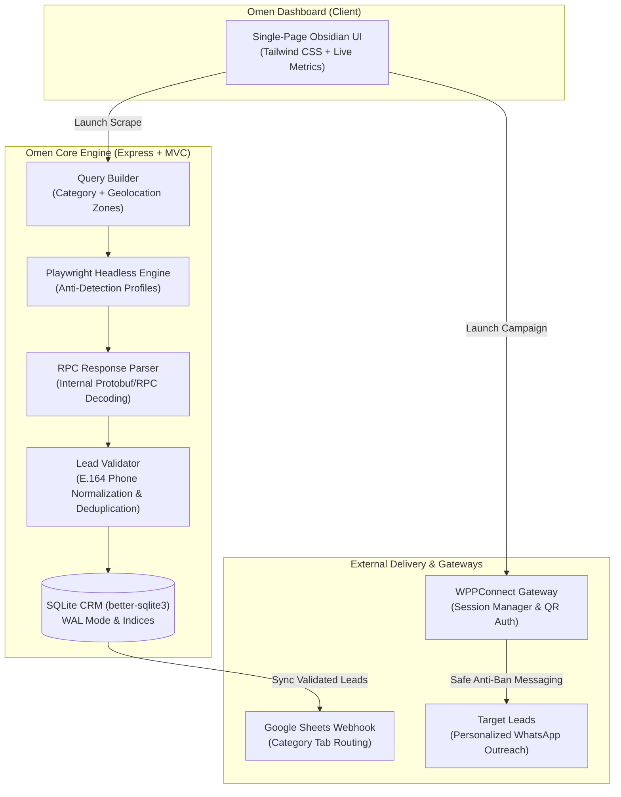

# 🦅 Omen — Intelligent Lead Discovery & Automated Outreach CRM

[](https://www.typescriptlang.org/)
[](https://nodejs.org/)
[](https://expressjs.com/)
[](https://playwright.dev/)
[](https://www.sqlite.org/)
[](https://tailwindcss.com/)

> **Omen** is an end-to-end B2B lead generation engine and automated CRM platform. It pairs high-speed browser automation with Google Maps RPC reverse-engineering, local SQLite persistence, automated Google Sheets synchronization, and an anti-ban WhatsApp outreach campaign runner.

---

## 📌 Architecture Overview



---

## 🚀 Key Features

### 1. 🔍 Precision Geolocation Scraping & RPC Reverse-Engineering
* **Dual Extraction Pipeline:** Pairs DOM scraping with intercepted Google Maps internal RPC network frames for high-fidelity extraction of business names, phone numbers, review ratings, categories, and Google Place IDs.
* **Multi-Zone Geographic Sweeper:** Automatically partitions searches across target municipalities and neighborhoods (e.g., Amman, Zarqa, Irbid, Aqaba) to bypass regional pagination limits.
* **Bottleneck Rate Limiting:** Built-in queue throttling and browser session randomization to evade bot-detection mechanisms.

### 2. 🗄️ Resilient SQLite CRM & Deduplication Engine
* **High-Throughput WAL Mode:** Powered by `better-sqlite3` configured with `WAL` (Write-Ahead Logging) and `NORMAL` synchronous mode for concurrent read/write transactions.
* **Seen Places Cache:** Instant \(O(1)\) deduplication using indexed Place IDs and normalized phone numbers to prevent re-scraping existing leads.
* **Audit Logs & Metrics:** Tracks scraping runs, daily counts, and outreach campaign histories in relational tables.

### 3. 📱 Automated WhatsApp Outreach & Anti-Ban Controls
* **Integrated WPPConnect Gateway:** Communicates with a local WhatsApp API server for session management and QR-code pairing directly inside the dashboard.
* **Human-Like Jitter & Cooldowns:** Configurable randomized send intervals (e.g., 45s ± 20s) and multi-minute batch cooldowns to safeguard WhatsApp accounts against automated bans.
* **Dynamic Template Variables:** Supports personalized placeholders (e.g., `{name}`, `{category}`, `{zone}`) with Spintax variation to ensure unique message hashing.

### 4. 📊 Two-Way Google Sheets Synchronization
* **Apps Script Webhook Integration:** Pushes new validated leads straight into organized category tabs in Google Sheets.
* **Status Ingestion:** Reads status changes (e.g., `New` vs `Sent`) directly from Google Sheets to trigger targeted outreach batches.

---

## 🛠️ Tech Stack

| Domain | Technologies |
| :--- | :--- |
| **Backend & API** | Node.js, TypeScript, Express.js (MVC Pattern), Zod |
| **Data Scraping** | Playwright, Bottleneck, Custom RPC Stream Parser |
| **Database & Cache** | SQLite 3 via `better-sqlite3`, WAL Mode |
| **Frontend UI** | HTML5, Tailwind CSS, JetBrains Mono & Plus Jakarta Sans |
| **Messaging Gateway** | WPPConnect Server (REST API / WebSocket) |
| **Cloud Integration** | Google Apps Script Webhooks (Google Sheets) |

---

## 📂 Project Structure

```text
Omen/
├── public/                 # Modern Obsidian dark-mode dashboard (index.html)
├── src/
│   ├── controllers/        # Express MVC controllers (Scraper, Outreach, Sheets, Config)
│   ├── db/                 # SQLite database schema, migrations & seeders
│   ├── models/             # Relational data models (Category, Zone, SeenPlace, Setting)
│   ├── routes/             # RESTful API route definitions
│   ├── leadValidator.ts    # Phone normalization, carrier identification & sanity checks
│   ├── outreachService.ts  # WhatsApp campaign orchestrator & anti-ban scheduler
│   ├── parser.ts           # DOM attribute parser for Google Maps results
│   ├── queryBuilder.ts     # Natural-language query generator
│   ├── rpcParser.ts        # Google Maps internal RPC network stream decoder
│   ├── scraper.ts          # Playwright browser lifecycle manager
│   ├── server_new.ts       # Express server initialization & static serving
│   ├── sheetsService.ts    # Google Sheets webhook sync client
│   └── types.ts            # TypeScript interfaces & type definitions
├── seed/                   # Geographic seed lists & zone configurations
├── wppconnect-server/      # WhatsApp Gateway server
├── .env.example            # Environment variable template
├── .gitignore              # Production gitignore rules
├── package.json            # Scripts and dependencies
├── SEARCH_ALGORITHM.md     # Detailed documentation of extraction algorithms
├── start-omen.bat          # Windows one-click launcher for Omen
└── start-whatsapp.bat      # Windows one-click launcher for WhatsApp Gateway
```

---

## ⚙️ Getting Started

### Prerequisites
* [Node.js](https://nodejs.org/) (v18 or higher recommended)
* [npm](https://www.npmjs.com/) or [yarn](https://yarnpkg.com/)
* Google Chrome / Chromium (installed automatically by Playwright)

### 1. Clone & Install Dependencies

```bash
git clone https://github.com/muhammed-ahmed-hassouna/Omen.git
cd Omen

# Install Omen dependencies
npm install

# Install Playwright browser binaries
npx playwright install chromium

# Install WhatsApp Gateway dependencies
cd wppconnect-server
npm install
cd ..
```

### 2. Configure Environment

Copy the `.env.example` template:

```bash
cp .env.example .env
```

Set your preferred configuration in `.env` (ports, session names, secret keys).

### 3. Run the Application

#### Option A: One-Click Windows Launchers
* Double-click `start-whatsapp.bat` to boot the WhatsApp Gateway (Port `21465`).
* Double-click `start-omen.bat` to boot the Omen Dashboard (Port `3000`).

#### Option B: Terminal Command

```bash
# Terminal 1: Start WhatsApp Gateway
cd wppconnect-server
npm run dev

# Terminal 2: Start Omen Server
npm run dev
```

Open your browser at: **`http://localhost:3000`**

---

## 🔒 Security & Privacy Notice

* All sensitive credentials, session tokens, and webhook URLs are configured strictly through environment variables and local settings.
* No live database records, WhatsApp credentials, or private contact lists are tracked in this repository.

---

## 📄 License & Rights

Copyright © 2026. All rights reserved.  
This project is showcased for portfolio and technical demonstration purposes.